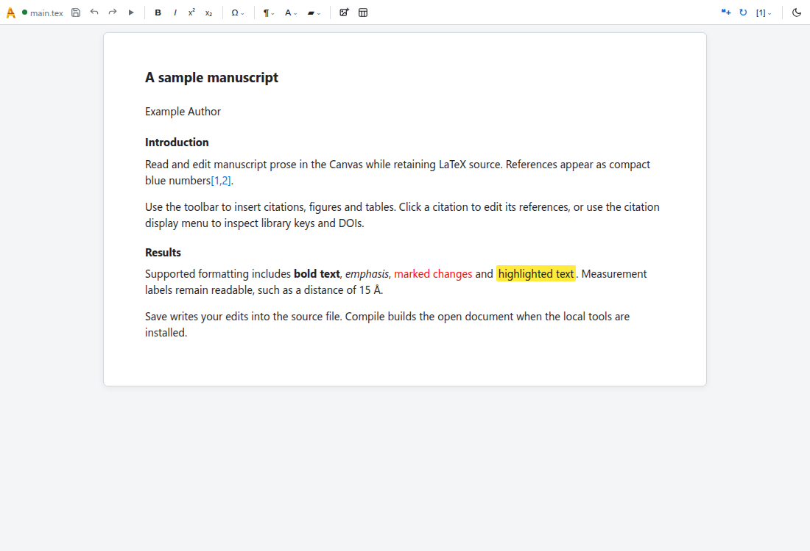

# Aspyrus

Aspyrus is an ultra-lightweight visual LaTeX prose editor for Visual Studio Code and compatible editors. Read and edit a manuscript in a live visual document canvas while keeping the `.tex` file as the 100% authoritative source.

The editor runs completely locally without an external server, Python, or a TeX installation. Optional compilation produces publication-ready PDF, editable Microsoft Word documents (`.docx`), and a figure-only PDF using local build tools.

## Installation

### 1. Download
Download the latest `aspyrus-0.6.1.vsix` package from the **[Releases](https://github.com/paulshamrat/aspyrus/releases)** page.

### 2. Install into VS Code

**Option A: Via Terminal (Quickest)**
```sh
code --install-extension aspyrus-0.6.1.vsix --force
```

**Option B: Via VS Code Extensions Menu**
1. Open VS Code.
2. Go to the Extensions view (`Ctrl+Shift+X` or `Cmd+Shift+X` on macOS).
3. Click the `...` (Views and More Actions) menu in the top-right corner.
4. Select **Install from VSIX…** and choose the downloaded `.vsix` file.
5. Reload VS Code (**Developer: Reload Window** in the Command Palette).

> **Note:** Installing the extension does not install LaTeX, Pandoc, or Python dependencies. Those are only required if you use the optional compile button.

## Start editing

1. Open a `.tex` file and select **Edit Text (Aspyrus)** from its editor title bar
   or context menu.
2. Edit prose, headings and captions in the Canvas. Use the compact toolbar for
   formatting, citations, figures and tables.
3. Click a blue citation number to edit its references. The citation-display menu
   switches between numbers, BibTeX keys and DOIs already in your library.
4. Press **Ctrl+S** to save into the LaTeX source. Use **Cmd+S** on macOS.
5. If build tools are installed, click **Compile** or press **Ctrl+Shift+B** to
   save and build the open document.

Save Canvas work before editing raw LaTeX: source-editor changes refresh the
Canvas, including when the Canvas contains unsaved work. To recover a previous
source version, focus the Canvas and run **Aspyrus: Restore Previous Version**.
Recovery covers text checkpoints, not bibliography files, images or exports.

## What it supports

- Prose, headings, lists, formatting and editable figure/table captions.
- Local image previews, figure insertion and figure copy/cut/paste with Undo/Redo.
- Numeric citations in brackets or superscripts, with library search and metadata
  tooltips. Numbered citations stay blue, compact and borderless.
- Standard `\cite`, `\textcolor`, `\hl` and supported mathematical notation.
- Light and dark themes, manual Save and local recovery checkpoints.
- Optional PDF/DOCX compilation with output ownership checks and recovery after
  interrupted publication.
- Explicit DOI-list import and bibliography metadata flags; see [script usage](example/scripts/README.md).
- A generic [example workspace](example/) with independently authored main and
  supplementary documents and optional asset, bibliography and feedback scripts.



Untouched source preservation is a development requirement covered by regression
checks. Aspyrus is not a complete LaTeX interpreter or a replacement for inspecting
compiled output; unsupported constructs and complex documents need source editing.

## Requirements and limits

- **Editor:** VS Code 1.85 or later. Compatible editors may differ; verify their
  extension-installation and shortcut support.
- **Compilation:** Python, Pandoc, Poppler, pdfLaTeX and BibTeX, plus the packages
  used by your document.
- **Platforms:** The build engine uses POSIX file locking; native Windows
  compilation is not supported. Editing does not use that Python build engine.
- **Documents:** The export path expects self-contained TEX with literal local
  paths. External `\input`/`\include` and complex custom float macros may require
  adaptation. Numeric citation support is not a full author–year style engine.
- **Word fidelity:** Equations remain native Word equations where supported.
  Layout, pagination and equation colours/highlights can differ between office
  applications; inspect the intended application before delivery.

## Documentation

- [Development and contributions](CONTRIBUTING.md)

## Contributing and licensing

Use generic examples when reporting problems; remove private manuscript content
and personal information. Include reproduction steps, editor/version, relevant
source and expected versus actual behaviour. Public issue and repository URLs
will be added when the release destination is selected.

See [CONTRIBUTING.md](CONTRIBUTING.md) for tests and release preparation,
[AGENTS.md](AGENTS.md) for coding-agent instructions, and
[CHANGELOG.md](CHANGELOG.md) for changes. Aspyrus is [MIT licensed](LICENSE).

The starter main and supplementary use left-aligned PDF/Word body text with
retained first-line indentation and 1.5 spacing. TEX uses ragged2e RaggedRight;
Word uses a 0.25-inch body indent. Captions retain justified formatting, while
headings, tables and equations retain their dedicated alignment.
